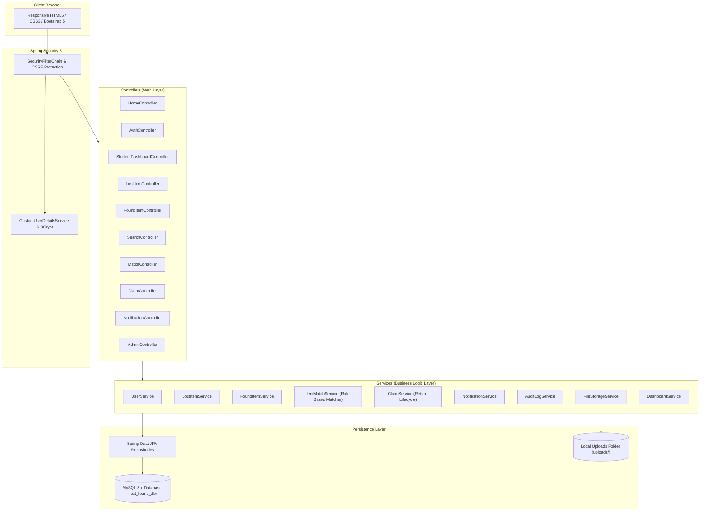
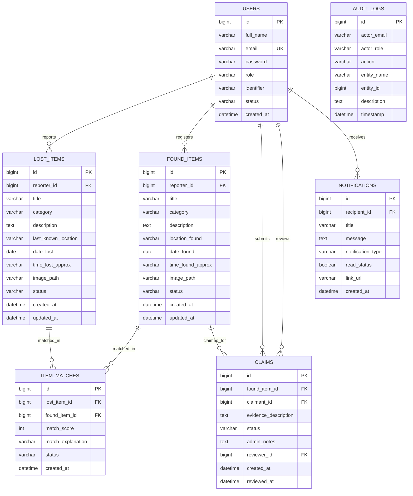

# CampusFind &mdash; Lost and Found Management System

> A Full-Stack Enterprise Java Web Application for College Campuses  
> Built with **Java 21**, **Spring Boot 3.3.5**, **Spring Security 6**, **Thymeleaf**, **Hibernate/JPA**, and **MySQL 8.x**

---

## 1. Project Background & Problem Statement

### 1.1 The Campus Problem
On a bustling college campus, students and faculty frequently misplace valuable belongings such as:
- Student & Staff Identity Cards (which restrict library and examination hall entry)
- Scientific Calculators (essential for engineering, mathematics, and AIML courses)
- Textbooks, lecture notebooks, and laboratory records
- Electronics (laptops, phones, earphones, flash drives, chargers)
- Keys, wallets, water bottles, and personal accessories

Traditional recovery mechanisms rely on unorganized WhatsApp/Telegram groups, informal security notices, and manual inquiries at security desks. This creates major operational problems:
1. Lost notices get lost in social chat feeds.
2. Finders cannot easily identify or contact true owners.
3. Lack of structured ownership verification risks handing items to unauthorized individuals.
4. No automated correlation exists between reported lost items and newly registered found items.

### 1.2 The CampusFind Solution
**CampusFind** is a centralized, secure web application that connects students, faculty, and campus administrators. It standardizes lost and found reporting, executes an automated rule-based potential item matching algorithm, provides a transparent ownership claim verification workflow, and maintains an immutable administrative audit trail.

---

## 2. Core Features & Capabilities

- **Role-Based Access Control**:
  - `ROLE_STUDENT`: Report lost/found items, view matches, submit ownership claims, track recovery, receive notifications.
  - `ROLE_STAFF`: Student privileges plus faculty verification assistance.
  - `ROLE_ADMIN`: Administrative moderation, claim approval/rejection with recorded notes, confirm physical handovers, manage user accounts/roles, view audit trail, and monitor campus analytics.
- **Lost & Found Reporting**: Distinct, structured forms with mandatory campus location, date/time, category, rich description, and optional photo upload.
- **Smart Potential Item Matching**: Transparent rule-based heuristic scoring (0 to 100 points) evaluating Category match (25 pts), Title text similarity (25 pts), Location proximity (20 pts), Date proximity (15 pts), and Description keyword overlap (15 pts). Generates plain-English match explanations.
- **Claim & Return Workflow**:
  - Claimant submits distinguishing ownership marks or evidence.
  - Item status moves to `UNDER_CLAIM` to alert other users.
  - Administrators review evidence and record decision notes.
  - In-person physical handover with student ID verification updates item to `RETURNED` and marks claimant's lost report as `RESOLVED`.
- **Database-Backed Search & Filtering**: Multi-parameter search by keyword, category, location, date range, and listing type with database-level pagination.
- **In-App Notification Center**: Dispatches alerts on claim status updates, new potential matches ($\ge 50\%$), and administrative decisions.
- **Platform Analytics**: Live database metrics including Active Lost Reports, Available Found Items, Returned Items, Pending Claims, and the Campus Recovery Rate.
- **Security & Safety**:
  - BCrypt password encryption.
  - CSRF token validation on all state-altering forms.
  - Protection against Path Traversal and executable file uploads with random UUID filenames.
  - Parameterized JPA queries preventing SQL injection.
  - Friendly error pages (403 Forbidden, 404 Not Found, 500 Server Error) without stack trace exposure.

---

## 3. Technology Stack

| Component | Technology | Version | Purpose |
| :--- | :--- | :--- | :--- |
| **Language** | Java | 21 / 25 LTS | Core backend programming |
| **Framework** | Spring Boot | 3.3.5 | Application architecture & auto-configuration |
| **Security** | Spring Security | 6.x | BCrypt password hashing, session & route authorization |
| **ORM / Data** | Spring Data JPA / Hibernate | 6.5.x | Object-Relational Mapping & parameterized queries |
| **Database** | MySQL | 8.x | Production relational database (`lost_found_db`) |
| **Testing DB** | H2 Database | 2.2.x | In-memory database for automated tests & dev profile |
| **Template Engine** | Thymeleaf | 3.1.x | Server-rendered HTML templates with Spring Security extras |
| **UI Styling** | Bootstrap 5 & Custom CSS | 5.3.3 | Responsive mobile, tablet, and desktop interface |
| **Validation** | Jakarta Bean Validation | 3.0.x | Server-side form constraints (`@NotBlank`, `@Size`, etc.) |
| **Build Tool** | Apache Maven | 3.9.x | Project dependency resolution & packaging |
| **Testing** | JUnit 5 & Mockito & MockMvc | Standard | Unit & integration testing |

---

## 4. System Architecture



---

## 5. Database Schema & ER Diagram



---

## 6. Project Folder Structure

```
lost-and-found/
├── .env.example                               # Environment variable template
├── .gitignore                                 # Git ignore configuration
├── mvnw.cmd                                   # Windows Maven wrapper
├── pom.xml                                    # Maven build file with all dependencies
├── README.md                                  # Comprehensive documentation
├── docs/                                      # College submission documentation
│   ├── problem-statement.md                   # Problem background & campus pain points
│   ├── requirements.md                        # Functional & non-functional requirements
│   ├── system-design.md                       # Architecture & sequence workflows
│   ├── database-design.md                     # MySQL schema & ER specifications
│   ├── test-cases.md                          # Test suite matrix & verification results
│   ├── user-manual.md                         # Step-by-step user & administrator manual
│   └── viva-questions.md                      # Viva questions & answers for 2nd year students
└── src/
    ├── main/
    │   ├── java/com/lostfound/
    │   │   ├── LostAndFoundApplication.java   # Spring Boot Main Entry Point
    │   │   ├── config/                        # Security, MVC resource & DataInitializer
    │   │   ├── controller/                    # Spring MVC Controllers (11 controllers)
    │   │   ├── dto/                           # Form objects & transfer DTOs
    │   │   ├── entity/                        # JPA Entities (User, LostItem, FoundItem, Claim, ...)
    │   │   ├── enums/                         # Status & Category Enums
    │   │   ├── exception/                     # Global exception advice & custom exceptions
    │   │   ├── repository/                    # Spring Data JPA Repository interfaces
    │   │   ├── security/                      # UserDetailsService implementation
    │   │   ├── service/                       # Business logic services
    │   │   └── util/                          # Text tokenization & Jaccard/Levenshtein matching
    │   └── resources/
    │       ├── application.properties         # Default configuration (MySQL)
    │       ├── application-h2.properties      # In-Memory test & standalone demo profile
    │       ├── static/                        # CSS, JS, and image assets
    │       └── templates/                     # Thymeleaf HTML5 views (26 templates)
    └── test/                                  # Unit & Integration Tests (16 passed tests)
```

---

## 7. Installation & Setup Instructions

### 7.1 Prerequisites
- **Java Development Kit (JDK)**: JDK 21 or later installed.
- **MySQL Server**: MySQL 8.x (Community Server or XAMPP / WampServer).
- **Maven**: Included via bundled wrapper or Maven 3.8+.

### 7.2 MySQL Database Setup on Windows
1. Open MySQL Command Line Client or MySQL Workbench.
2. Execute the following SQL statement:
   ```sql
   CREATE DATABASE lost_found_db CHARACTER SET utf8mb4 COLLATE utf8mb4_unicode_ci;
   ```
3. Verify that your MySQL server is running on `localhost:3306`.

### 7.3 Environment Variables Configuration
Copy the provided `.env.example` file or configure your local environment:
- `DB_URL`: `jdbc:mysql://localhost:3306/lost_found_db?createDatabaseIfNotExist=true&useSSL=false&serverTimezone=UTC&allowPublicKeyRetrieval=true`
- `DB_USERNAME`: `root`
- `DB_PASSWORD`: *(Your MySQL root password)*
- `ADMIN_EMAIL`: `admin@campus.edu`
- `ADMIN_PASSWORD`: `Admin@12345`

*Note: Hibernate automatically creates and updates all database tables (`ddl-auto=update`), so manual table creation is not required.*

### 7.4 Building and Running the Project

#### Option A: Running with MySQL (Default)
In PowerShell or Command Prompt inside the `lost-and-found` folder:
```powershell
.\mvnw.cmd spring-boot:run
```
Or with environment variables:
```powershell
$env:DB_USERNAME="root"; $env:DB_PASSWORD="your_password"; .\mvnw.cmd spring-boot:run
```

#### Option B: Running with H2 In-Memory Profile (Instant Demo without MySQL)
If MySQL is not installed or running, you can start the application immediately using the included H2 profile:
```powershell
.\mvnw.cmd spring-boot:run "-Dspring-boot.run.profiles=h2"
```
Or run the packaged JAR directly:
```powershell
java -jar target\lost-and-found-system-1.0.0.jar --spring.profiles.active=h2
```

### 7.5 Accessing the Application
Once the server starts up, open your browser and navigate to:
```
http://localhost:8080/
```

### 7.6 Initial Administrator Setup & Demo Accounts
On the first application launch, `DataInitializer.java` automatically initializes:
- **Campus Administrator**:
  - Email: `admin@campus.edu`
  - Password: `Admin@12345`
  - Role: `ROLE_ADMIN`
- **Demo Student**:
  - Email: `student@campus.edu`
  - Password: `Student@12345`
- **Demo Staff Member**:
  - Email: `staff@campus.edu`
  - Password: `Staff@12345`

---

## 8. Running Automated Tests

To execute the complete JUnit 5 and Mockito test suite:
```powershell
.\mvnw.cmd test
```
**Test Results**: 16/16 Tests Passed (100% Success).

---

## 9. How to Demonstrate in Front of an Examiner

1. **Start the Application**: Run `.\mvnw.cmd spring-boot:run` or launch the packaged jar.
2. **Open the Homepage (`http://localhost:8080/`)**: Point out genuine database statistics (Active Lost, Available Found, Recovery Rate) and the responsive search bar.
3. **Login as Student (`student@campus.edu`)**:
   - Navigate to the **Student Dashboard**.
   - Show reported items and active claims.
4. **Demonstrate Lost Item Reporting**:
   - Click **Report Lost Item**.
   - Enter *"Casio Scientific Calculator fx-991EX"*, Category: *Calculator*, Location: *Room 204*, Date: *Today*.
   - Submit the form.
5. **Demonstrate Smart Potential Matching**:
   - Open the lost item report details.
   - Show the **Potential Matches** card. Notice the computed **Match Score (e.g. 85%)** and the transparent **Match Explanation** (*"Identical category, title similarity, location proximity, date proximity"*).
6. **Submit an Ownership Claim**:
   - Click **Claim This Item**.
   - Enter distinguishing proof (*"Barcode sticker ending in 42 on the back cover"*).
   - Submit the claim. Notice that found item status transitions to `UNDER_CLAIM`.
7. **Login as Administrator (`admin@campus.edu`)**:
   - Open `/admin/dashboard`.
   - Point out the **Recovery Rate** calculation, **Location Hotspots**, and **Category Breakdown**.
   - Navigate to **Review Claims** (`/admin/claims`).
   - Click **Review Claim**, approve the claim with an administrator pickup note.
   - Click **Confirm Handover & Return**. Notice status becomes `RETURNED` and the matched lost report is automatically marked `RESOLVED`.
   - Navigate to `/admin/audit` to show the permanent, immutable audit log.

---

## 10. Suggested Task Division for Two Team Members

| Member | Primary Focus Areas | Presentation / Viva Responsibilities |
| :--- | :--- | :--- |
| **Team Member 1** | **Backend Architecture & Security**<br>&bull; Spring Security configuration & BCrypt hashing<br>&bull; Entity modeling, JPA repositories & MySQL schema<br>&bull; User authentication & role-based route protection<br>&bull; File upload validation & path traversal prevention | Present system architecture, Spring Security filter chain, BCrypt salt hashing, CSRF protection, and database relationships. |
| **Team Member 2** | **Business Logic & Full-Stack UI**<br>&bull; Rule-based smart matching algorithm (`ItemMatchService`)<br>&bull; Token extraction, Jaccard similarity & Levenshtein distance<br>&bull; Claim & physical handover return lifecycle<br>&bull; Thymeleaf templates, responsive Bootstrap UI, & testing | Present the matching heuristic algorithm, claim verification workflow, live platform analytics, and demonstrate the end-to-end user scenario. |

---

## 11. Git & GitHub Pushing Instructions (No Secrets Committed)

1. Verify that `.gitignore` is in place (it already ignores `.env`, `target/`, and `uploads/`).
2. Initialize git and commit:
   ```powershell
   git init
   git add .
   git commit -m "Initial commit: Complete Campus Lost and Found Management System"
   ```
3. Link your remote repository and push:
   ```powershell
   git branch -M main
   git remote add origin https://github.com/your-username/campus-lost-and-found.git
   git push -u origin main
   ```
   *No passwords or database secrets are committed.*
